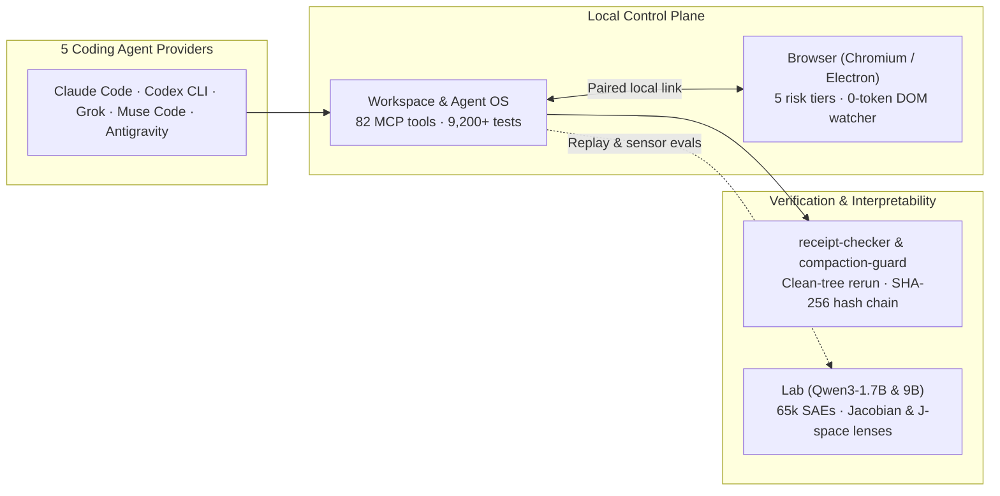

# Keegan Choudhury

AI product manager and systems builder in Washington, DC (open to SF Bay Area). I build multi-agent runtimes, agent browsers, and local mechanistic interpretability tools.

**[keegan.ai](https://www.keegan.ai)** · **[Paper (KDD '25 Workshop)](https://arxiv.org/abs/2508.11715)** · **[US Patent App. US20250378320A1](https://patents.google.com/patent/US20250378320A1/en)** · **[Writing](https://www.keegan.ai/writing/agents-need-direction.html)** · **[LinkedIn](https://www.linkedin.com/in/keeganchou)**



---

### Systems I've Built

| System | Stack | Scale & Verification | Technical Mechanism |
| :--- | :--- | :--- | :--- |
| **[Workspace](https://www.keegan.ai/workspace/)** & **Agent OS** | TypeScript, Node 24, `node-pty` (1 runtime dep) | **3,215 commits** · **8,738** Workspace tests + **188** Agent OS test files | Orchestrates 5 AI providers over 1 shared MCP server (**82 tools**). 10-state append-only goal log, 8-state input-safe delivery (never overwrites an unsent human draft), and SHA-256 hash-chained audit logs. |
| **[Browser](https://www.keegan.ai/browser/)** | Chromium / Electron 44, TypeScript | **860 tests** across 92 files · **56** privacy checks | Agents act only in user-picked tabs. Classifies every action into 5 risk tiers before execution (money, deletion, credentials require single-use human approval). Local DOM watcher runs every 15s with **0 model calls / 0 tokens**. |
| **Lab** | Python, PyTorch, `Qwen3-1.7B` & `Qwen3.5-9B` | **240 unit tests** (no GPU/net required) · 12 GB RTX 3060 | Streams a 1 GiB **65,536-feature** sparse autoencoder in 128 MiB slices from RAM so a 19.3 GB 9B model fits in **7.3 GB VRAM**. Implements Jacobian lenses (within `3.4e-5` of Anthropic's reference across 27 layers), J-space decomposition, causal residual-stream branching (`Rome − Paris` flips output at `0.1× \|h\|` at layer 24 vs. `0/336` random pushes), and a duty-cycle GPU scheduler. |
| **[receipt-checker](https://github.com/keeganarko/receipt-checker)** | Node.js, Git object store, Bash (`FSL-1.1-MIT`) | **154 tests** (Ubuntu & macOS, Node 20/22/24) · **0 deps** | Verifies an agent's "done" receipt by exporting the exact 40-char commit from git's object store into an empty folder (bypassing `git archive` so `export-ignore` cannot hide a failing test), rerunning checks in `env -i`, and logging verdicts in a SHA-256 hash chain. |
| **[compaction-guard](https://github.com/keeganarko/compaction-guard)** | Node.js Claude Code `PreCompact` hook (`FSL-1.1-MIT`) | **1 file** · **0 deps** · live-tested in Claude Code | Built after measuring that **393 of 441** agent save requests across 203 rounds were pre-empted by active user typing. Streams a transcript copy, verifies SHA-256 readback, writes a receipt, and blocks compaction on failure. |
| **Trading Engine** & **Observatory** | Python stdlib, SQLite, IBKR read-only feed | **152 commits** · **43** unit + **76** Playwright GUI checks | 17 annual expanding-window fits (**4,197** outcomes) with `AsOf` causal lookup guards verified by future-label perturbation tests. Daily listed-option quote replay pricing bid/ask spread crossing (`~1.5` pts/trade, `~0.65%` annual CAGR drag on `QQQ`) + byte-pinned `HALT` controls. |
| **[Dreamcatcher](https://www.keegan.ai/dreamcatcher/)** | TypeScript, React, evaluation harness | **150 tests** · **99%** line coverage | Links AI claims to captured source passages, recorded reviews, and challenge gates that withhold evidence scores while an objection is open. |

---

### Research & Patents

- **[Benchmark Dataset Generation and Evaluation for Excel Formula Repair with LLMs (FoRepBench)](https://arxiv.org/abs/2508.11715)** — *KDD 2025 Workshop on Evaluation and Trustworthiness of Agentic and Generative AI Models*. Co-author (1 of 13 at Microsoft; scenarios, evaluation criteria, writing). Across **618** benchmark examples generated from **59** user-forum seeds and scored by live spreadsheet execution + LLM judge:
  ```text
  GPT-4.1   ████████████████  80% synthetic (618)   ████████  41% forum seeds (59)
  GPT-4o    ███████████████   73% synthetic (618)   ███████   35% forum seeds (59)
  Phi-3     ████████████      58% synthetic (618)   █████     24% forum seeds (59)
  Mistral   ██████████        51% synthetic (618)   ████      19% forum seeds (59)
  ```
- **[Generative agent guided conversations for artifact completion](https://patents.google.com/patent/US20250378320A1/en)** — *US Patent Application `US20250378320A1`* (filed June 2024, published Dec 2025, assigned to Microsoft Technology Licensing LLC). Co-inventor (1 of 9). An AI agent interviews a user across turns to populate a structured artifact while code validates each `update_artifact` call against the form's schema.

---

### Experience & Education

- **Capital One** · Product Manager *(2025–present)* — Delayed go-live 2 weeks after shadow testing caught old-vs-new response mismatches, then migrated the **Venture X** card portfolio to a platform serving **4.3M requests/month** with **0 customer-facing outages**. Leading 13-engineer Collections & Recoveries monitoring across SMS, email, mobile, and web.
- **Microsoft** · Product Manager *(2023–2025)* — Helped shape and ship **Excel Formula Repair** in the Copilot pane and grid right-click menu for Excel for the web. Led a 5-person team building a daily-use internal **LLM support assistant** with graph retrieval (**~95%** of hand-graded test cases solved without an engineer; **$1.07M** modeled annual productivity value).
- **Tesla** · Technical Program Manager Intern *(2022)* — Automated vehicle-door part validation using SQL and Postman, raising manufacturing line throughput **~23%**.
- **Texas A&M University** — B.S. Computer Science, **Summa Cum Laude** (**3.94 GPA**, 2023).
