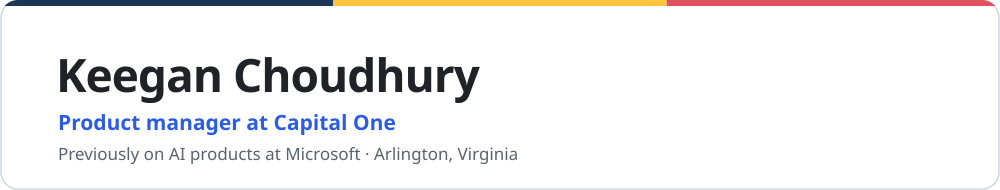

<picture>
  <source media="(prefers-color-scheme: dark)" srcset="assets/banner-dark.svg">
  
</picture>

I'm a product manager at Capital One, and before that I worked on AI products at Microsoft. On the side I build tools for working with coding agents.

[keegan.ai](https://www.keegan.ai) · [LinkedIn](https://www.linkedin.com/in/keeganarko) · [Résumé](https://www.keegan.ai/assets/Keegan-Choudhury-Resume.pdf)

## Things I've built

 **[Relay](https://www.relayaiworld.com)** &nbsp; 
A project I'm co-building. It warns two people when their agents are about to change the same code.

 **[Agent Hub](https://www.keegan.ai/workspace/)** &nbsp; 
Five coding agents work on one project. A change only counts as done once its checks pass again from a clean copy.

 **[Model Lab](https://github.com/keeganarko/model-lab)** &nbsp; 
How I look inside small open models on my own GPU.

 **[receipt-checker](https://github.com/keeganarko/receipt-checker)** &nbsp; 
Rebuilds a commit in an empty folder and runs its checks again.

 **[compaction-guard](https://github.com/keeganarko/compaction-guard)** &nbsp; 
A Claude Code hook that saves and verifies a transcript before it is compacted.

 **[Browser](https://www.keegan.ai/browser/)** and **[Dreamcatcher](https://www.keegan.ai/dreamcatcher/)** &nbsp; 
An agent browser that only works in the tabs you pick, and an early tool for checking an AI answer against its sources.

Research: [FoRepBench](https://arxiv.org/abs/2508.11715), a KDD 2025 workshop paper, and a [patent application](https://patents.google.com/patent/US20250378320A1/en) with Microsoft.
