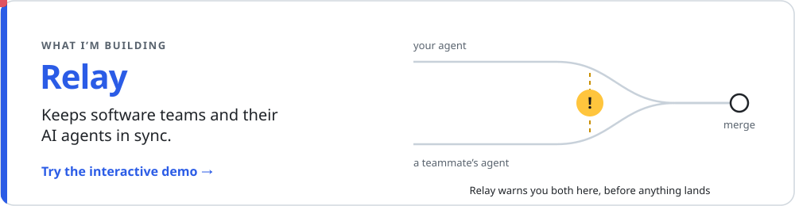
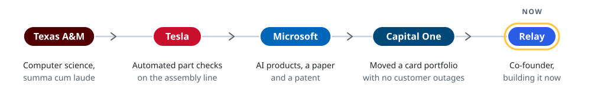

<picture>
  <source media="(prefers-color-scheme: dark)" srcset="assets/hero-dark.svg">
  
</picture>

## Hi, I'm Keegan

I'm co-founding [Relay](https://www.relayaiworld.com) from Arlington, Virginia. Relay keeps software teams and their AI coding agents in sync. When your agent and a teammate's agent start changing the same code, it tells you both before anything merges.

It started as my own problem. I work with five coding agents every day (Claude, Codex, Gemini, Grok and Muse), and getting them to write code was never the hard part. The hard part was keeping them pointed at the same goal, stopping them from writing over each other and over me, and knowing when "done" really meant done. I kept building tools to fix that, and Relay is where they all led. I wrote about what I learned in [Agents need direction](https://www.keegan.ai/writing/agents-need-direction.html).

Before Relay I was a product manager at Microsoft, working on AI, and then at Capital One.

[keegan.ai](https://www.keegan.ai) · [Relay](https://www.relayaiworld.com) · [LinkedIn](https://www.linkedin.com/in/keeganchou) · [Résumé](https://www.keegan.ai/assets/Keegan-Choudhury-Resume.pdf)

 

<a href="https://www.relayaiworld.com/demo.html">
  <picture>
    <source media="(prefers-color-scheme: dark)" srcset="assets/relay-dark.svg">
    
  </picture>
</a>
  

Relay sits beside the tools teams already use, like Claude Code, Cursor and Codex. It notices when two people's agents are about to collide, checks changes in a sandbox before they land, and only shares context with people who are cleared to see all of it.

## Things I've built along the way

###  Agent Hub

My home base. Five coding agents work on one project, share notes and tools, and hand work to each other. A change only counts as done once its checks pass again from a clean copy, and if I'm in the middle of typing, the agents wait. My draft always wins. Written in TypeScript on Node, with a shared MCP server every agent plugs into. [See how it works](https://www.keegan.ai/workspace/)

###  Model Lab

How I look inside small open models on my own GPU. It reads a model one layer at a time with lenses and sparse autoencoders, and can nudge a layer while the model is thinking to test cause and effect against random controls. It streams the big feature dictionaries in small slices, so a 9B model fits on an ordinary graphics card. I kept the negative results in too. Python and PyTorch, on Qwen models. [Read the code](https://github.com/keeganarko/model-lab)

###  receipt-checker

Agents kept telling me tests passed when they hadn't. This tool ignores the claim. It rebuilds the exact commit in an empty folder, runs the checks again, and writes down what really happened in a log that shows any later edits. Plain Node.js, nothing else to install. [Read the code](https://github.com/keeganarko/receipt-checker)

###  compaction-guard

A small Claude Code hook. Before a long conversation gets compacted, it saves the whole transcript, checks the copy matches, and stops the compaction if it doesn't, so nothing important quietly disappears. [Read the code](https://github.com/keeganarko/compaction-guard)

###  Earlier experiments

- [**Browser**](https://www.keegan.ai/browser/), a browser built for agents where they only touch the tabs you hand them, and anything involving money, deleting things or passwords waits for your OK.
- [**Dreamcatcher**](https://www.keegan.ai/dreamcatcher/), an early try at arguing with an AI answer. Every claim links back to its source, and scores wait while an objection is still open.
- **An options replay harness** that keeps me honest about cause and effect. It replays real option quotes without peeking at the future.

## Where I've been

<picture>
  <source media="(prefers-color-scheme: dark)" srcset="assets/journey-dark.svg">
  
</picture>

I studied computer science at Texas A&M and interned at AT&T, Microsoft (on HoloLens) and Tesla. Then I spent two years as a product manager at Microsoft working on AI: I helped ship Formula Repair in Excel, led a small team building a support assistant that engineers used every day, and worked on agents that guide people through a conversation. At Capital One I led moving the Venture X card portfolio onto a new platform without customers noticing. Now all of that goes into Relay.

## Research

**[FoRepBench](https://arxiv.org/abs/2508.11715)**, KDD 2025 workshop. With my Microsoft colleagues I built a benchmark for how well language models repair broken Excel formulas, scoring each fix by actually running it. The lesson that stuck with me: models that look great on generated test cases do about half as well on the messy problems real people post in forums.

**[Generative agent guided conversations for artifact completion](https://patents.google.com/patent/US20250378320A1/en)**, a US patent application with Microsoft, where I'm one of the inventors. An agent interviews you to fill in a document, while plain code checks every field before anything is saved.

## Say hi

If your team runs coding agents and they keep colliding, I'd love to hear about it. The best way to reach me is through [keegan.ai](https://www.keegan.ai) or [LinkedIn](https://www.linkedin.com/in/keeganchou).
